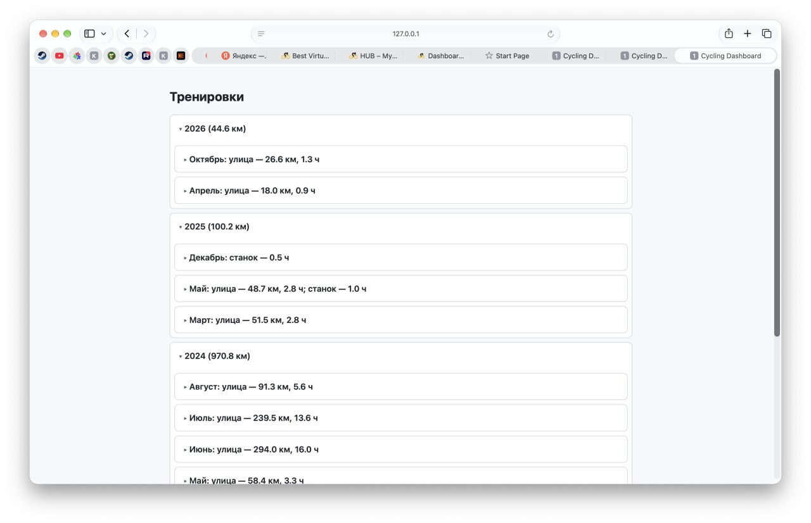
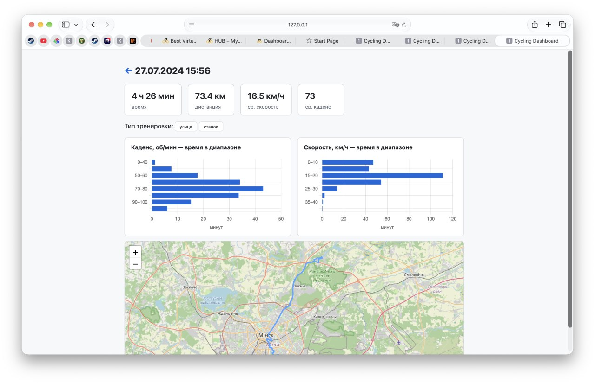

# cycling-dashboard

Личный дашборд велотренировок из FIT-файлов с велокомпа Cycplus C2. Список тренировок по годам/месяцам, деталка с графиками и картой, BLE-синхронизация с устройством — одним бинарником, без внешних зависимостей.




## Возможности

- **Дерево тренировок**: год → месяц → тренировки. Месяц показывает сплит по типу: `улица — N км, X ч; станок — X ч, Y ккал`
- **Деталка тренировки**: длительность, дистанция, скорость, каденс, мощность, пульс, калории (≈ кДж работы, считаются из мощности)
- **Распределение по диапазонам**: время в бакетах по каденсу / скорости / мощности / пульсу (горизонтальные бар-чарты)
- **График мощности** по времени для тренировок с поверметром
- **Карта маршрута** на OpenStreetMap (Leaflet) для уличных поездок
- **Поиск** по имени и дате
- **Имена тренировок** — задаются вручную
- **Определение станка**: нет GPS, либо размах трека < 1 км (C2 пишет дрейфующие координаты даже на станке), либо FIT помечен как `indoor_cycling`. Ручной override на деталке
- **Геймификация**: калории за месяц переводятся в «пиццы пепперони» — 1 пицца = 2400 ккал (Domino's Пепперони Делюкс 100, L, 950 г)
- **BLE-синхронизация** с Cycplus C2 (представляется как `M2_XXXX`) — кнопка в вебе, качает только новые файлы
- **Инкрементальный импорт** по хешу файла — повторный запуск подхватывает только новое

## Запуск

Нужен Go 1.24+ и macOS/Linux (BLE-синх — только macOS, см. ниже).

```sh
go run ./cmd/server
# или бинарник:
go build -o cycling-dashboard ./cmd/server && ./cycling-dashboard
```

Флаги:

| Флаг | По умолчанию | Описание |
|------|--------------|----------|
| `-dir` | `tracks` | папка с FIT-файлами |
| `-db` | `cycling.db` | путь к SQLite |
| `-addr` | `127.0.0.1:8080` | адрес сервера |

Откроется `http://127.0.0.1:8080`.

## API

JSON-эндпоинты для программного доступа к данным тренировок (используются, в т.ч., AI-скиллом для разбора поездок). Базовый URL — `http://127.0.0.1:8080`.

### `GET /api/workouts`

Список всех тренировок от новых к старым. Элементы — полные объекты тренировки:

```json
[
  {
    "ID": 308,
    "StartTime": "2026-10-29T20:48:57+03:00",
    "Name": "Ramp Test",
    "Duration": 3021000000000,
    "DistanceKm": 0,
    "HasGPS": true,
    "Trainer": true,
    "AvgSpeedKmh": 23.7,
    "MaxSpeedKmh": 27.6,
    "AvgCadence": 80,
    "MaxCadence": 134,
    "AvgPower": 96,
    "MaxPower": 155,
    "NormPower": 97,
    "AvgHR": 0,
    "MaxHR": 0,
    "Calories": 290,
    "AscentM": 0,
    "DescentM": 1,
    "HasPower": true,
    "FTP": 156,
    "WeightKg": 75
  }
]
```

- `Duration` — в **наносекундах** (Go `time.Duration`)
- `FTP` / `WeightKg` — штампы профиля на момент тренировки (от них считаются зоны, чтобы история не пересчитывалась при обновлении профиля)
- `AvgHR`/`MaxHR` = 0 — датчик пульса не был подключён

### `GET /api/workouts/latest`

Последняя по дате старта тренировка — тот же объект, что в списке. Удобна как health-check (`curl -sf …/api/workouts/latest`).

### `GET /api/workout/{id}`

Детали одной тренировки по ID (формат объекта — как выше). 404, если нет.

### `GET /api/workout/{id}/dist`

Распределение времени по бакетам, посчитанное по полным сэмплам. Ключи — только для метрик с данными:

```json
{
  "power":   [{"label": "Z1 · 0–86",   "secs": 230}, {"label": "Z2 · 87–118", "secs": 2250}],
  "cadence": [{"label": "70–80",       "secs": 582}, {"label": "80–90",       "secs": 2318}],
  "speed":   [{"label": "0–10",        "secs": 45}],
  "hr":      [{"label": "120–130",     "secs": 1200}]
}
```

- `power` — зоны Коггана Z1–Z7 в ваттах от FTP-штампа тренировки (если FTP не задан — фиксированные диапазоны 0–50…400+ Вт)
- `cadence` — бакеты по 10 об/мин (0–40 … 100+)
- `speed` — бакеты по 10 км/ч
- `hr` — бакеты по 10 уд/мин
- `secs` — суммарное время в бакете

### `GET /api/workout/{id}/samples`

Сэмплы для графиков, усреднённые до ~500 точек (лимит захардкожен):

```json
[
  {"Offset": 0, "Power": 95, "HasPwr": true, "Cadence": 78, "HasCad": true,
   "HR": 132, "SpeedMs": 6.5, "Lat": 0, "Lon": 0, "HasPos": false, "AltitudeM": 0,
   "HasAlt": false, "DistanceM": 0, "HasDist": false}
]
```

- `Offset` — секунды от старта тренировки
- флаги `HasPwr`/`HasCad`/`HasPos`/`HasAlt`/`HasDist` — были ли данные в сэмпле (нулевые значения без флага = «нет данных», а не 0)

### Пример: разобрать последние тренировки

```sh
# id и даты всех тренировок
curl -s http://127.0.0.1:8080/api/workouts | jq '.[] | {id: .ID, date: .StartTime, name: .Name}'

# детали + зоны по мощности для конкретной
curl -s http://127.0.0.1:8080/api/workout/308 | jq '{avg: .AvgPower, norm: .NormPower, ftp: .FTP}'
curl -s http://127.0.0.1:8080/api/workout/308/dist | jq '.power'
```

## Синхронизация с велокомпом

1. Включи Cycplus C2, положи рядом с компьютером
2. Закрой приложение Cycplus на телефоне (оно держит BLE-соединение)
3. Нажми **«Синхронизировать с велокомпом»** в шапке дашборда

Скачанные файлы падают в `-dir`, после синка база обновляется автоматически. Протокол — Nordic UART Service (`6e400001-…`), Go-порт оригинального `cycSync.py`.

**Про Docker**: BLE не заведётся — на macOS Docker живёт в VM без доступа к Bluetooth. Программа и так один статический бинарник, докерить незачем.

## Технические заметки

- **Скейлы FIT**: `tormoder/fit` отдаёт сырые значения, скейлы из FIT-профиля применяются в `internal/importer` руками (время ×1000, дистанция ×100, скорость ×1000). Меняя парсер — не потерять это
- **`tinygo.org/x/bluetooth`**: vanity-домен tinygo.org периодически отдаёт битый go-get; в `go.mod` стоит `replace` на `github.com/tinygo-org/bluetooth` — при обновлении зависимости проверить, нужен ли он ещё
- **Сэмплы хранятся все** (~250k на 50 треков), API прореживает до 500 точек для графика; распределения считаются по полным данным, время сэмпла = интервал до следующего (паузы не размазываются)
- Треки в `tracks/` — личные данные, в git не коммитятся (`.gitignore`)

## Структура

```
cmd/server/        точка входа, флаги
internal/importer  FIT → SQLite (tormoder/fit, скейлы, детект станка)
internal/store     SQLite-схема, миграции, запросы
internal/web       chi-хендлеры, шаблоны (embed), API графиков, sync-менеджер
internal/blesync   BLE-клиент для Cycplus C2 (tinygo.org/x/bluetooth)
tracks/            FIT-файлы (не коммитятся)
```
