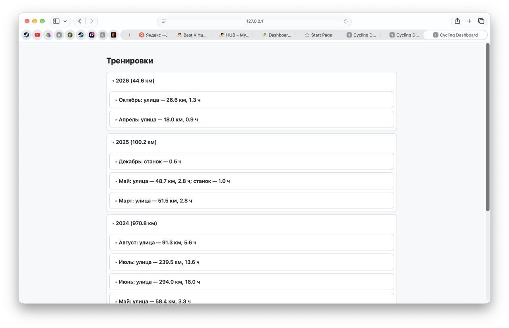
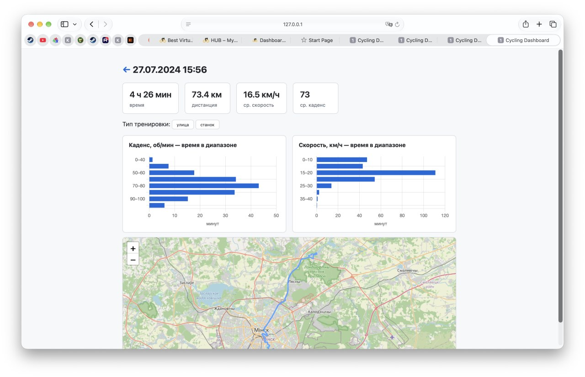

# cycling-dashboard

Личный дашборд велотренировок из FIT-файлов с велокомпа Cycplus C2. Список тренировок по годам/месяцам, деталка с графиками и картой, BLE-синхронизация с устройством — одним бинарником, без внешних зависимостей.




## Возможности

- **Дерево тренировок**: год → месяц → тренировки. В строке тренировки — средняя мощность и TSS, месяц показывает сплит по типу (`улица — N км, X ч; станок — X ч, Y ккал`), суммарный TSS и средний IF (квадратичное среднее `sqrt(Σ(IF²·t)/Σt)`)
- **Деталка тренировки**: длительность, общее время и паузы, дистанция, скорость, каденс, мощность, пульс, калории. Для мощности — IF, TSS, VI и средняя «в работе»; если `no_power_sec + suspect_dropout_sec` больше 5% времени в движении (`duration_sec`), показывается жёлтый бейдж «данные с пропусками» с расшифровкой в подсказке (у тренировок без поверметра бейджа нет)
- **Распределение по диапазонам**: время в бакетах по каденсу / скорости / мощности / пульсу (горизонтальные бар-чарты). Для мощности накат — отдельный бакет `0 Вт · накат`, а под баром подписаны обе базы: время педалирования и время вместе с накатом
- **График мощности** по времени для тренировок с поверметром
- **Карта маршрута** на OpenStreetMap (Leaflet) для уличных поездок
- **Поиск** по имени и дате
- **Имена тренировок** — задаются вручную
- **Определение станка**: нет GPS, либо размах трека < 1 км (C2 пишет дрейфующие координаты даже на станке), либо FIT помечен как `indoor_cycling`. Ручной override на деталке
- **Геймификация**: калории за месяц переводятся в «пиццы пепперони» — 1 пицца = 2400 ккал (Domino's Пепперони Делюкс 100, L, 950 г)
- **BLE-синхронизация** с Cycplus C2 (представляется как `M2_XXXX`) — кнопка в вебе, качает только новые файлы
- **Инкрементальный импорт** по хешу файла — повторный запуск подхватывает только новое

## Запуск

Нужен Go 1.26+ (см. `go.mod`) и macOS/Linux (BLE-синх — только macOS, см. ниже).

```sh
go run ./cmd/server
# или бинарник:
go build -o cycling-dashboard ./cmd/server && ./cycling-dashboard
```

Флаги:

| Флаг | По умолчанию | Описание |
|------|--------------|----------|
| `-dir` | `tracks` | папка с FIT-файлами |
| `-db` | `cycling.db` | путь к SQLite |
| `-addr` | `127.0.0.1:8080` | адрес сервера |
| `-reimport` | `false` | перечитать все `.fit` из `-dir` заново (после изменений парсера). Обычные бэкфиллы (`subsport`, `np_version`, `metrics`) при старте отрабатывают сами |

Откроется `http://127.0.0.1:8080`.

## API

JSON-эндпоинты для программного доступа к данным тренировок (используются, в т.ч., AI-скиллом для разбора поездок). Базовый URL — `http://127.0.0.1:8080`.

### `GET /api/workouts`

Список всех тренировок от новых к старым. Элементы — полные объекты тренировки:

```json
[
  {
    "ID": 308,
    "StartTime": "2026-10-29T20:48:57+03:00",
    "Name": "Ramp Test",
    "Duration": 3021000000000,
    "DistanceKm": 0,
    "HasGPS": true,
    "Trainer": true,
    "SubSport": "generic",
    "AvgSpeedKmh": 23.7,
    "MaxSpeedKmh": 27.6,
    "AvgCadence": 80,
    "MaxCadence": 134,
    "AvgPower": 96,
    "MaxPower": 155,
    "NormPower": 97,
    "NPVersion": 4,
    "IF": 0.622,
    "TSS": 32.4,
    "VI": 1.01,
    "AvgPowerActive": 96,
    "CoastingSec": 17,
    "NoPowerSec": 513,
    "SuspectDropoutSec": 0,
    "ElapsedSec": 3020,
    "PauseSec": 0,
    "WorkKJ": 240.3,
    "AvgTemp": 24.6,
    "HasTemp": true,
    "MetricsVersion": 1,
    "AvgHR": 0,
    "MaxHR": 0,
    "Calories": 290,
    "AscentM": 0,
    "DescentM": 1,
    "HasPower": true,
    "FTP": 156,
    "WeightKg": 75
  }
]
```

- `Duration` — в **наносекундах** (Go `time.Duration`)
- `FTP` / `WeightKg` — штампы профиля на момент тренировки (от них считаются зоны, чтобы история не пересчитывалась при обновлении профиля)
- `SubSport` — подсорт из FIT-сессии (`generic`, `indoor_cycling`, `road`, `mountain`, …). Пустая строка, если устройство его не записало
- `IF` / `TSS` / `VI` / `WorkKJ` — метрики нагрузки (формулы — в «Технических заметках»). **`null`** — данных нет (например, у тренировки без поверметра); число — значение известно, причём `WorkKJ: 0` при `HasWork: true` — валидный ноль
- `AvgPowerActive` / `CoastingSec` / `NoPowerSec` / `SuspectDropoutSec` / `ElapsedSec` / `PauseSec` — целые секунды/ватты, 0 = нет данных
- `AvgTemp` / `HasTemp` — средняя температура: `AvgTemp: 0` при `HasTemp: true` — честные 0 °C
- `AvgTemp` / `HasTemp` — средняя температура записей, °C (появится только после ре-импорта старых файлов: в старых сэмплах температуры нет)
- `MetricsVersion` — версия формул метрик
- `AvgHR`/`MaxHR` = 0 — датчик пульса не был подключён

### `GET /api/workouts/latest`

Последняя по дате старта тренировка — тот же объект, что в списке. Удобна как health-check (`curl -sf …/api/workouts/latest`).

### `GET /api/workout/{id}`

Детали одной тренировки по ID (формат объекта — как выше). 404, если нет.

### `GET /api/workout/{id}/dist`

Распределение времени по бакетам, посчитанное по сырым сэмплам из БД (без бакет-усреднения: иначе на записи 2 Гц нули мощности смешались бы с педалированием и накат бы пропал). Ключи — только для метрик с данными:

```json
{
  "power":   [{"label": "0 Вт · накат", "secs": 818, "pct": 0, "pctTotal": 15.7},
              {"label": "Z1 · 0–87.4",  "secs": 232, "pct": 5.3, "pctTotal": 4.5},
              {"label": "Z2 · 87.4–118.6", "secs": 548, "pct": 12.5, "pctTotal": 10.5}],
  "powerBase": {"coastSecs": 818, "pedalSecs": 4379, "totalSecs": 5197},
  "cadence": [{"label": "0–40",       "secs": 73,   "pct": 0, "pctTotal": 0},
              {"label": "50–60",      "secs": 309,  "pct": 0, "pctTotal": 0}],
  "speed":   [{"label": "0–10",       "secs": 247,  "pct": 0, "pctTotal": 0},
              {"label": "15–20",      "secs": 1706, "pct": 0, "pctTotal": 0}]
}
```

Фрагмент реального ответа для тренировки 418 (в ответе все 8 бакетов мощности и все бакеты остальных метрик). Ключа `hr` в нём нет: у неё не был подключён пульсометр, а ключи отдаются только для метрик с данными (`hr` появится у тренировок с датчиком).

- `power` — зоны Коггана Z1–Z7 в ваттах от FTP-штампа тренировки (если FTP не задан — фиксированные диапазоны 0–50…400+ Вт). Пороги в подписях — реальные, без округления до целых (`87.4–118.6` при FTP 156); правая граница в зону не входит. Первым всегда идёт бакет **`0 Вт · накат`** — свободный ход (мощность ноль при живом поверметре)
- `cadence` — бакеты по 10 об/мин (0–40 … 100+)
- `speed` — 0–10, дальше по 5 км/ч (10–15, 15–20, …, 40+)
- `hr` — бакеты по 10 уд/мин
- `secs` — суммарное время в бакете
- `pct` / `pctTotal` — доля бакета в процентах: `pct` от времени педалирования, `pctTotal` от общего времени вместе с накатом. Поля есть у всех бакетов (у `cadence`/`speed`/`hr` — нули, чтобы клиент мог суммировать без проверок на `undefined`). У бакета наката `pct` всегда 0 (накат — не педалирование), сумма `pct` по «педалирующим» бакетам и сумма `pctTotal` по всем ≈ 100
- `powerBase` — две базы времени мощности: `coastSecs` (накат), `pedalSecs` (педалирование, power > 0), `totalSecs` (их сумма). Процент времени в зонах исторически считался от `pedalSecs` — `powerBase` показывает, что за база

Отличать накат от дропаута: `power == 0` при `HasPwr` — это накат, он попадает в нулевой бакет. Отсутствие мощности (поверметр отвалился, `HasPwr: false`) не попадает ни в один бакет. Нули по каденсу / скорости / пульсу по-прежнему не учитываются.

Время записи — интервал до следующего сэмпла; записи с одинаковым `ts_offset` (например, запись 2 Гц) делят интервал до следующего различного offset поровну. Разрыв больше 5 с — это либо пауза (1 с), либо прореживание записи при движении (полный интервал, но не больше 60 с — `ridedata.MaxGapSec`). Признаки в порядке приоритета: (1) прирост `distance_m` на границах разрыва, если дистанция известна с обеих сторон (перед авто-паузой в записи остаётся последняя «ещё ехавшая» скорость, а расстояние уже не растёт); (2) скорость на границе от 1 км/ч — ехали; (3) если ни дистанции, ни скорости нет — педалирование: есть мощность или каденс — ехали, нет — стояли. Правило одинаковое для всех бакетов — и для наката, и для зон мощности.

### `GET /api/workout/{id}/samples`

Сэмплы для графиков. По умолчанию бакет-усредняются до ~500 точек:

```json
[
  {"Offset": 0, "Power": 95, "HasPwr": true, "Cadence": 78, "HasCad": true,
   "HR": 132, "SpeedMs": 6.5, "Lat": 0, "Lon": 0, "HasPos": false, "AltitudeM": 0,
   "HasAlt": false, "DistanceM": 0, "HasDist": false, "TempC": 17, "HasTemp": true}
]
```

| Параметр | По умолчанию | Описание |
|----------|--------------|----------|
| `max` | `500` | верхняя граница числа точек, от 1 до 200000 — возвращается **не больше** `max` |
| `raw` | `0` | `raw=1` — отдать все сэмплы как есть, без бакет-усреднения (для внешнего анализа нужны честные медиана и пики); `max` при этом игнорируется и не валидируется, а тренировка длиннее 200000 сэмплов — 400 |

Некорректный параметр (`max=abc`, `max=0`, `max=-5`, `max` больше потолка, `raw=maybe`) — **400** с текстом ошибки.

- `Offset` — секунды от старта тренировки
- флаги `HasPwr`/`HasCad`/`HasPos`/`HasAlt`/`HasDist`/`HasTemp` — были ли данные в сэмпле (нулевые значения без флага = «нет данных», а не 0)
- `TempC` — температура записи, °C (в FIT — sint8)
- если `max` меньше числа сэмплов, точки — бакеты: `Offset` и значения усредняются по попавшим в бакет записям (offset — среднее, а не `MIN`: точка смещается к центру бакета и не садится на край длинной паузы); у известной тренировки без сэмплов ответ `[]`, у неизвестной — 404

```sh
# все 5281 сэмплов тренировки без усреднения
curl -s 'http://127.0.0.1:8080/api/workout/418/samples?raw=1' | jq length
```

### Пример: разобрать последние тренировки

```sh
# id и даты всех тренировок
curl -s http://127.0.0.1:8080/api/workouts | jq '.[] | {id: .ID, date: .StartTime, name: .Name}'

# детали + зоны по мощности для конкретной
curl -s http://127.0.0.1:8080/api/workout/308 | jq '{avg: .AvgPower, norm: .NormPower, ftp: .FTP}'
curl -s http://127.0.0.1:8080/api/workout/308/dist | jq '.power'
```

## Синхронизация с велокомпом

1. Включи Cycplus C2, положи рядом с компьютером
2. Закрой приложение Cycplus на телефоне (оно держит BLE-соединение)
3. Нажми **«Синхронизировать с велокомпом»** в шапке дашборда

Скачанные файлы падают в `-dir`, после синка база обновляется автоматически. Протокол — Nordic UART Service (`6e400001-…`), Go-порт оригинального `cycSync.py`.

**Про Docker**: BLE не заведётся — на macOS Docker живёт в VM без доступа к Bluetooth. Программа и так один статический бинарник, докерить незачем.

## Технические заметки

- **Скейлы FIT**: `tormoder/fit` отдаёт сырые значения, скейлы из FIT-профиля применяются в `internal/importer` руками (время ×1000, дистанция ×100, скорость ×1000). Меняя парсер — не потерять это
- **NP (нормализованная мощность)**: считается по Коггану и только если устройство само его не отдало. Скользящее среднее берётся за **30 секунд по `ts_offset`**, а не за 30 сэмплов — при записи не 1 Гц окно в сэмплах плывёт. Дальше x⁴ → среднее → ⁴√. И скользящее среднее внутри окна, и итоговое среднее считаются по времени (вес — `ridedata.Timings.Secs`): при неравномерной записи (smart recording, 2 Гц) NP не перекашивается в сторону плотно записанных участков. Дропауты поверметра заполняются последним значением (fill-forward); окно обрывает только разрыв-стоянка — по тому же правилу `internal/ridedata`, что и распределения (дистанция → скорость → педалирование), а прореженная при движении запись окно не рвёт. Версия алгоритма пишется в `workouts.np_version` (`NPVersion` в API); при старте сервера тренировки со старой версией пересчитываются из сохранённых сэмплов (одной транзакцией), без перечитывания FIT. Тренировки без сэмплов, без валидной мощности или с одними нулями при device-NP > 0 не трогаются — device-NP не затирается нулём (все нули при ненулевом NP похожи на залипший датчик), они остаются с прежней, меньшей актуальной версией до появления данных. Полный ре-импорт из файлов — флаг `-reimport`
- **`tinygo.org/x/bluetooth`**: vanity-домен tinygo.org периодически отдаёт битый go-get; в `go.mod` стоит `replace` на `github.com/tinygo-org/bluetooth` — при обновлении зависимости проверить, нужен ли он ещё
- **Температура**: `record.temperature` (sint8, invalid 0x7F) пишется в `samples.temperature`, среднее по непустым — в `workouts.avg_temp` (0 °C и отрицательные — валидные значения, NULL только при отсутствии данных). Старые сэмплы температуры не имеют: чтобы заполнить историю, нужен `-reimport` (файлы Cycplus её содержат)
- **Метрики нагрузки** (колонки `workouts.if/tss/vi/...`, в API — `IF`, `TSS`, `VI`, `AvgPowerActive`, `CoastingSec`, `NoPowerSec`, `SuspectDropoutSec`, `ElapsedSec`, `PauseSec`, `WorkKJ`, `MetricsVersion`) считаются при импорте после штампов профиля; время — из `ridedata.Timings`, того же источника, что NP и распределения:
  - `if = NP / ftp_w` (NULL, если NP=0 или FTP=0)
  - `tss = duration_sec × NP × IF / (ftp_w × 3600) × 100` (NULL без NP/FTP)
  - `vi = NP / avg_power` (NULL, если avg_power=0; от FTP не зависит)
  - `avg_power_active` — средняя только по `power > 0`; `coasting_sec` — время `power == 0`; `no_power_sec` — время без данных (`power IS NULL`); `suspect_dropout_sec` — `power == 0` при `cadence > 0` (похоже на отвал датчика)
  - `elapsed_sec` — `TotalElapsedTime` из FIT-сессии; `pause_sec = elapsed_sec − duration_sec`, отрицательное — 0; `work_kj` — `TotalWork` из сессии (джоули → /1000), если он записан и больше нуля, иначе `Σ(power × Secs) / 1000`
  - invalid-маркеры таймеров (`0xFFFFFFFF`) отсекаются: иначе `duration_sec` стал бы ~49.7 дней и TSS взорвался
  - `MetricsVersion` — версия формул; при старте строки со старой версией пересчитываются из сэмплов одной транзакцией, а `elapsed_sec`/`work_kj` дочитываются из FIT-сессии (если файл на месте, иначе остаются NULL). TSS считается от `duration_sec`, поэтому заполняется и у тренировок без сэмплов, если есть NP и FTP
  - при изменении FTP (`BackfillProfileStamps`) или NP (`SetNormPowers`) у затронутых строк сбрасывается `MetricsVersion` — метрики пересчитываются сразу после правки профиля и при следующем старте; если FTP или NP исчез, IF/TSS обнуляются (VI пересчитывается — он от FTP не зависит). Вес на метрики не влияет и их не инвалидирует
  - запись профиля, пересчёт штампов и метрик идут одной транзакцией: ошибка пересчёта откатывает всё и отдаёт 500, а не «сохранено»
- **Осиротевшие сэмплы** (`workout_id=0` от старого импорта, а также ссылки на удалённые тренировки) не видны ни одному запросу и чистятся идемпотентной миграцией при старте (`DELETE` + лог количества). Если таблица `workouts` пуста, чистка пропускается с предупреждением — иначе недосозданная база потеряла бы все сэмплы. На чистой базе удаляется 0 строк и строка в лог не пишется
- **`workouts.subsport`** заполняется из FIT-сессии при импорте. Для уже импортированных тренировок при старте сервера отрабатывает бэкфилл (`importer.BackfillSubSport`, по образцу `store.BackfillProfileStamps`): он перечитывает FIT только у строк с `subsport_checked = 0` и ставит этот флаг даже если в файле subsport нет, поэтому повторный старт файлы не читает, а пользовательские `name` и `trainer_override` не перетираются. Если файла нет на диске, строка с предупреждением помечается проверенной (значение `subsport` при этом сохраняется) — иначе чтение и предупреждение повторялись бы каждый старт; вернувшийся файл подхватит `-reimport`. Если нет и каталога (похоже на неверный `-dir`), строку не помечаем — после исправления пути бэкфилл отработает сам; существующая, но пустая папка трактуется как «файлов больше нет». Остальные ошибки чтения (битый FIT, права) оставляют строку непроверенной — они могут быть временными
- **Cycplus C2 пишет `subsport = generic` даже для станка**, поэтому тип тренировки определяется не по нему, а по GPS и размаху трека (см. «Определение станка»)
- **Сэмплы хранятся все** (266 414 записей на 54 тренировки в текущей базе), API по умолчанию прореживает их до 500 точек для графика (`?max=N` — свой лимит, `?raw=1` — все сэмплы без усреднения); распределения считаются по полным данным, время сэмпла = интервал до следующего (паузы обрезаются, прореженная при движении запись — нет)
- Треки в `tracks/` — личные данные, в git не коммитятся (`.gitignore`)

## Структура

```
cmd/server/        точка входа, флаги
internal/importer  FIT → SQLite (tormoder/fit, скейлы, детект станка)
internal/ridedata  общие правила времени записей и пауз (NP и распределения)
internal/store     SQLite-схема, миграции, запросы
internal/web       chi-хендлеры, шаблоны (embed), API графиков, sync-менеджер
internal/blesync   BLE-клиент для Cycplus C2 (tinygo.org/x/bluetooth)
tracks/            FIT-файлы (не коммитятся)
```
